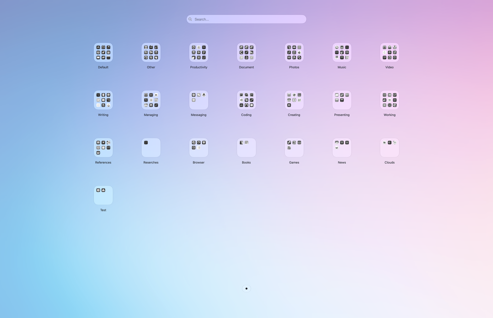
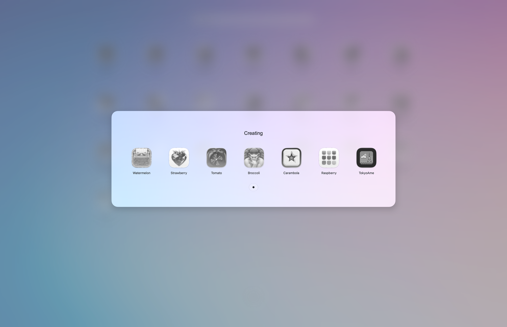

# 🫐Raspberry: A Better Launchpad

<p align="center"><b>English</b> · <a href="README_cn.md">简体中文</a></p>

<p align="center">
  
</p>

<p align="center"><a href="https://t.me/+AODLypeF_aYwYjNh">Telegram</a> | <a href="https://twitter.com/ryanswindows">Twitter</a> | <a href="https://weibo.com/ryanthehitos">Weibo</a></p>

<p align="center"><a href="https://github.com/Ryan-the-hito/Raspberry/releases/latest"><b>Download the latest version</b></a></p>

**Raspberry is a full-screen app launcher for the Mac: the Launchpad you knew, with your own groups, rebuilt in Liquid Glass.** Click its Dock icon and every app on your Mac is there on the blurred wallpaper; click a group and it opens as a pane of glass. You sort things by right-click, by dragging or from the keyboard, and Raspberry keeps your groups, their order and your pages in plain files on your own Mac.

Latest version: **v0.0.20** · Interface languages: English / 简体中文 / 日本語

From v0.0.17 on there is **one Raspberry**. The Free and Pro editions have been merged: everything the Pro edition had (importing your Launchpad groups, backups, languages, aliases, drag sorting) is in the one download.

<details>
<summary>Old introduction (v0.0.16 and earlier, outdated)</summary>


~~Raspberry is another macOS Launchpad alternative and even better to help you organize your groups on macOS Tahoe.~~

</details>

## Why Raspberry

Since macOS 26, Launchpad is gone. In its place is a new app called "Apps". It sorts your software into categories by itself, but you can no longer make your own groups or decide the order. For anyone who had spent years arranging Launchpad, that arrangement simply disappeared.

Raspberry brings it back, and fixes three things that were never good in the original:

1. **Your old groups come with you.** Before you upgrade from macOS 15, Raspberry can read the groups you already have in Launchpad and keep them. After the upgrade they are there again. You can also save the current arrangement at any time and go back to any saved one.

2. **Grouping does not have to be dragging.** In Launchpad the only way to make a group was to drag one icon onto another, and moving an app from page 9 to a group on page 1 meant carrying it across the screen. In Raspberry you right-click an app and choose the group. Dragging is there too, with a list of your groups at both sides of the screen while you drag, so the target is never far away.

3. **The keyboard can do everything.** Move the focus with the arrow keys, open with Return, open the right-click menu with Shift + Return, swap two icons, flip pages, close: all without the mouse.

## Highlights

### The look: Liquid Glass

- **The background is your wallpaper, blurred.** Raspberry shows a blurred picture of the clean wallpaper of the screen it is on, not of whatever windows happen to be open behind it.
- **Groups are small panes of glass** with the first nine icons on them. A click opens the group as a glass panel that grows out of its tile; everything behind it blurs and gets darker.
- **The page dots sit in a glass capsule** at the bottom, large enough to click.
- **The whole screen is Raspberry's**, as it was with Launchpad: the menu bar is covered while the launcher is open. Move the mouse to the top edge and the menu bar is back, so Raspberry's own menus and the system's icons stay within reach.
- Light and dark appearance both follow the system.
- Right-click menus, alerts and the About / Update / Guide windows are the system's own.

### Groups

Right-click an app:

| Choice | What it does |
|---|---|
| **Combine into a group** | Put the app into one of your groups, or into a **🆕 New group**. |
| **Move to another group** | (inside a group) Move it to a different group. |
| **Put it back to the main interface** | (inside a group) Take it out of the group. |
| **Hide in Raspberry** | The app no longer shows in Raspberry. It is not deleted; bring it back from *Actions › 🙈 Hidden apps*. |
| **Move to the trash can** | Moves the app itself to the Trash. |

Right-click a group: **Rename** or **Dissolve this group** (its apps go back to the main interface).

- Putting an app into a group, taking it out, moving it to the Trash and dissolving a group are all animated: the icon flies to where it goes and the others slide into the gap.
- Two groups cannot have the same name.
- The order of your groups is the same everywhere: on the main interface, in the right-click menu and in the lists at the sides while you drag.

### Sorting by dragging

- Drag an app or a group on the main interface to put it somewhere else. Inside an open group, drag to sort its apps.
- While you drag an app, **a glass list appears at each side of the screen**: your groups, and "New group" at the end. Drop the app on a name and it goes into that group.
- With *📄 Keep every page on its own* switched on, the list on the right shows your pages instead, so an app or a group can be dropped straight onto another page.

### Pages

- Flip pages with a swipe on the trackpad, the mouse wheel, the arrow keys or a click on a dot. The old page slides out while the new one slides in, as in the system's Launchpad.
- **📄 Keep every page on its own** (off by default). Off: the icons are one long row cut into pages, and a gap is filled from the next page. On: each page keeps its own icons, and removing one does not pull the others across.
- **🗜 Compact Mode**: the columns move as close together as the rows. Useful on a wide screen.
- **Flipping speed**: a slider in the Actions menu.
- The icons are sized to the screen, and a group's panel always fits the screen it is on: smaller icons first, then fewer rows per page.

### Search

Type in the search box at the top to filter by name. *🧽 Clear search when closing* empties the box each time the launcher is closed.

### Keyboard

Two layouts. The new one is the default; switch with *Actions › ⌨️ New keyboard navigation*.

| Key | New keyboard navigation (default) | Old layout |
|---|---|---|
| ← / → | Move the focus left / right | Previous / next page |
| ↑ / ↓ | Move the focus up / down | Move the focus up / down |
| Space / Shift + Space | Focus the next / previous icon | Focus the next / previous icon |
| Shift + ← / → | Previous / next page | Swap the focused icon with its neighbour |
| ⌃ or ⌥ or ⌘ + ← / → | Swap the focused icon with its neighbour | |
| Return | Open the app or the group | Open the app or the group |
| Shift + Return | Open the right-click menu | Open the right-click menu |
| Tab | Leave the open group | Leave the open group |
| Esc | Close the launcher | Close the launcher |
| ⌘W | Close the launcher | Close the launcher |

The focused icon has a ring in the system's accent colour.

### Bring your Launchpad groups, and keep backups

- **▶️ Back up Launchpad groups to Raspberry**: on macOS 15, reads the groups you have in Launchpad and builds the same groups in Raspberry.
- **🗂️ Backup current groups**: saves the arrangement as it is now.
- **🔄 Restore backups**: goes back to any saved arrangement.

### Every app, found by itself

- On the first start Raspberry indexes the apps on this Mac and keeps the icons. It does not depend on Spotlight.
- While it runs, it looks for newly installed and removed apps by itself.
- **👤 Also show apps in my own Applications folder** (off by default): adds the apps in `~/Applications`. Switched off again, they go; switched on again, they return to the group and the place they had.
- **📝 Set custom alias**: give an app the name you want to see. **♻️ Reset all aliases to Finder names** undoes all of them.
- **🔤 Sort ungrouped apps alphabetically**.
- **❇️ Update the specified app icon cache**: when one app has changed its icon. **🧹 Clear icon cache and refresh all apps** does it for all of them.

### Where it shows

- **The Dock.** By default Raspberry hides the Dock while it is open and brings it back when it closes. *🪟 Always show Dock* keeps the Dock visible (Raspberry leaves room for it); *🌀 Always hide Dock* keeps it hidden.
- **🖥 Show on all Spaces** (off by default). On: Raspberry follows you from desktop to desktop and can open over another app's full-screen Space. Raspberry restarts once when you switch this on.
- **🖼 Blur the wallpaper only** (on by default). Off: the old look, a blur of whatever is behind the window.
- **🕹 Traditional Mode** (on by default): one click opens, a click on an empty spot closes, as in Launchpad. Off: the double-click mode of the early versions.
- **🛠️ Start on login**.

### Works with Broccoli and other AI apps

Raspberry offers its functions as a set of 26 tools (MCP), so an AI can manage your apps for you: "put these apps into one group", "hide the apps I never use", "sort the loose apps by name".

- **Tools.** See the app list and the layout of each page, open an app, create / rename / dissolve groups, add apps to a group and take them out, sort inside a group, sort the launcher and move items between pages, hide and restore apps, give an app another name, the switches in the menu, the paging speed, update one icon, back up, rescan apps, move an app to the Trash, open and close the launcher, search, turn pages.
- **With [Broccoli](https://github.com/Ryan-the-hito/Broccoli) on the same Mac**, the tools attach to Broccoli by themselves; nothing to set up. When Raspberry is not running, it is opened in the background when needed, without showing the launcher.
- **Other AI apps** (Claude Desktop, Claude Code, Cursor, Codex and so on): click *Actions › 🔌 Use in other AI apps…*. The setup is copied; paste it into that app's MCP settings. Once is enough: the tools of the author's other apps on this Mac (Tomato, Broccoli, Watermelon, Strawberry) come along.
- **What AI does not get**: restoring a backup, clearing all groups, importing from Launchpad, clearing the icon cache, *Show on all Spaces* and the language. These stay in the menu. Read-only tools are used directly; for tools that change something, the AI app decides whether to ask you first.
- The service runs on this Mac only (127.0.0.1), with a new password at every start.

### One-click update

*Info › 🆕 Check for Updates*. Raspberry also checks shortly after it starts and once a day. When there is a new version, it downloads it, checks it, replaces itself and opens again. Your groups and settings stay.

### Your data stays on your Mac

Everything is in this folder, as ordinary files:

```
~/Library/Application Support/com.ryanthehito.raspberry/RaspberryAppPath
```

- `groups.json`, `main_order.json`, `app_order.json`: your groups and the order of everything.
- `alias_names.json`, `display_names.json`: the names shown.
- `Settings/`: one small file per switch.
- `Backups/`: the arrangements you saved.

The icon cache is in `~/Library/Caches/com.ryanthehito.raspberry/icon_cache` and can be deleted at any time.

Up to v0.0.16 these were hidden files in your home folder (`~/.launchpad_…`, `~/.raspberry_…`). The first start of a newer version moves them here and keeps a copy of the old ones in `Backups/before_move_<time>`.

<details>
<summary>Old feature descriptions and demo videos (v0.0.16 and earlier, outdated)</summary>

The videos below show the look before Liquid Glass. What they demonstrate still works, except where the text above says otherwise.

~~**Import existing Launchpad groups**~~

https://github.com/user-attachments/assets/48e4dd4a-f630-4f49-9d56-ee80bacad3e1

~~**Backup and restore**~~

https://github.com/user-attachments/assets/030cad24-007d-4323-98c9-90f302cabd41

~~**First launch**~~

https://github.com/user-attachments/assets/6097778f-b5f9-4b0a-8b89-98c0152532d1

~~**Launching apps**~~

https://github.com/user-attachments/assets/efa1de8d-48ad-4aec-996f-f4d6dcd7bbd3

~~**Right-click grouping**~~

https://github.com/user-attachments/assets/db7b64ef-cf7a-4388-8944-2e09988c282e

~~**Keyboard (old layout)**~~

https://github.com/user-attachments/assets/1f9132fe-fadc-4546-ba25-61e39bf4abf5

https://github.com/user-attachments/assets/51c203c0-aabb-492f-b1c2-c2e58c7354a3

https://github.com/user-attachments/assets/7813bd5f-c71b-4171-aa5d-3e5075128d69

https://github.com/user-attachments/assets/88fe9d73-cb61-4089-a64d-d3f4c5e2b703

https://github.com/user-attachments/assets/d3466a4f-16c7-42a4-a476-dfe829f9c823

https://github.com/user-attachments/assets/169274b2-dbaa-40f4-b3ae-cde79a0ef8fb

https://github.com/user-attachments/assets/09f8772c-4bd4-4e84-bc49-a8d5e2106320

https://github.com/user-attachments/assets/e783b225-b88b-4d3e-8642-3202b0f5c1cd

~~**Removed drag-and-drop from native Launchpad**: Raspberry prefers the right-click method, so this feature is no longer added.~~ (Dragging is back since v0.0.14 inside groups and since v0.0.17 everywhere.)

</details>

## Interface

1. The main interface: your groups and apps on the blurred wallpaper, the search box at the top, the page dots in a glass capsule at the bottom.

<p align="center">
  
</p>

2. An open group: a glass panel over the dimmed, blurred launcher.

<p align="center">
  
</p>

<details>
<summary>Old screenshots (v0.0.16 and earlier, outdated)</summary>


</details>

## Requirements

- A Mac with Apple silicon (M series).
- macOS 15 or later. Raspberry is developed and tested on macOS 27. The Liquid Glass look needs macOS 26 or later; earlier systems have not been specially tested with this version.

## Download and install

1. Open the [latest release](https://github.com/Ryan-the-hito/Raspberry/releases/latest) and download the `.dmg` file under *Assets* (for example `Raspberry_v0.0.20.1.dmg`).
2. Open the DMG and drag Raspberry into the Applications folder.
3. Open Raspberry. On the first start it indexes your apps and their icons; this can take up to a few minutes. Please wait and do not quit it. It does not happen again afterwards.
4. Permissions, in *System Settings › Privacy & Security*:
   - **Automation**: allow it when macOS asks. Raspberry uses it to hide and show the Dock.
   - **Screen Recording** (optional): Raspberry never asks for it. If it already has it, the blurred background is taken from the wallpaper exactly as it is on the screen, moving wallpapers included; without it, Raspberry reads the wallpaper's picture file.
5. **Later updates**: *Info › 🆕 Check for Updates* does the rest.
   - **Coming from v0.0.18 or earlier: install this version by hand once** (download the DMG and replace the app). The one-click update in v0.0.18 downloads the new version but cannot swap it in after quitting; it really works from v0.0.19 on.
   - If you had the Free edition: this is now the full Raspberry, with everything the Pro edition had.
   - Your groups are kept. On the first start the data moves to the new folder (see "Your data stays on your Mac"); Raspberry tells you once when it has done so.

<details>
<summary>Old installation notes and pricing (v0.0.16 and earlier, outdated)</summary>

~~The free version only includes basic features, while the paid version, in addition to the basic features, also has advanced features (importing existing Launchpad groups, manual backup and restore, languages other than English).~~

~~To buy a paid and signed build, visit the Buy me a coffee page, fill in your name and email address, and you will receive the Pro version software package.~~

~~Updating apps: download the DMG and choose "replace".~~

</details>

## How to use

1. **Open and close.** Click Raspberry's icon in the Dock to open the launcher; click it again to close. Esc, ⌘W and a click on an empty spot also close it. When you start Raspberry yourself, the launcher appears as soon as it is ready; when it starts at login, it stays in the background.
2. **Open an app or a group.** One click. A group opens as a panel; click outside it, or press Tab, to go back.
3. **Make a group.** Right-click an app › *Combine into a group* › *🆕 New group*, or drag the app onto "New group" in the list at the side. Right-click the group to rename it.
4. **Put things in order.** Drag icons and groups, or focus one with the arrow keys and swap it with its neighbour (⌃ / ⌥ / ⌘ + ← / →). *🔤 Sort ungrouped apps alphabetically* does the loose apps in one go.
5. **Reach the menus.** The launcher covers the menu bar. Move the mouse to the top edge of the screen: the menu bar appears, with Raspberry's **Actions**, **Info** and **Language** menus. Every switch mentioned on this page is in Actions.
6. **Moving from macOS 15 to macOS 26 or later.** Do this **before** you upgrade the system:
   1. Install and open Raspberry on macOS 15.
   2. Choose *Actions › ▶️ Back up Launchpad groups to Raspberry*.
   3. Upgrade the system.
   4. Open Raspberry: your groups are there.
7. **When something looks wrong.**
   - One app shows an old icon: *❇️ Update the specified app icon cache* and pick the app.
   - Many icons are wrong: *🧹 Clear icon cache and refresh all apps*. Do not click it twice and do not quit before it has finished.
   - Start over: *🗑 Reset All Data and Restart* removes Raspberry's groups and settings (not your apps). If importing from Launchpad did not work, do this and import again.
8. **The guide inside the app**: *Info › 🔤 Guide and Support*.

## Notes

1. Coming from v0.0.18 or earlier, install by hand once; from then on the update is one click.
2. Save your arrangement now and then with *🗂️ Backup current groups*.
3. *Move to the trash can* moves the app itself to the Trash. *Hide in Raspberry* only stops showing it.
4. With *🖥 Show on all Spaces* on, Raspberry starts without its Dock icon for a moment and shows it once its windows are ready. That is intended.

## Q&A

If something does not work, see **[Q&A](https://github.com/Ryan-the-hito/Q-A)❓** first, or [write to me](mailto:sweeter.02.implant@icloud.com).

## License

GPL-3.0. See the LICENSE file.

## Credits

1. [Qt](https://github.com/qt) / PyQt6
2. [blacktop/lporg](https://github.com/blacktop/lporg) (MIT): reads the Launchpad arrangement.

Thank you to everyone who sent suggestions and reports.

## Support the author

If you like Raspberry, a Star or an Issue helps. Raspberry is free; if you want to support its development:

[](https://www.buymeacoffee.com/ryanthehito)

<p align="center">
  
  
</p>

## Versions

### v0.0.20

Fixed:

1. With *Show on all Spaces* on, Raspberry could not open over another app's full-screen Space (v0.0.19 only).
2. After a change of screen resolution, the dimmed background behind an open group kept its old size; it now follows the new size, and the old picture no longer flashes up.

Improved:

1. Change the resolution while the launcher is up and it follows at once (window, wallpaper, icon size, open group).

### v0.0.19

New:

1. Opens faster: the first opening after starting takes about 0.3 seconds instead of 1–3; Raspberry no longer reads every app's information file at each start; hiding and showing the Dock happens in the background.
2. When you start Raspberry yourself, the launcher appears as soon as it is ready; when it starts at login, it still stays in the background.
3. Works with Broccoli and other AI apps: 26 tools (MCP) for the app list, groups, order, pages, hidden apps, names, switches, backups. They attach to Broccoli by themselves; for other AI apps, *Actions › 🔌 Use in other AI apps…* copies the setup.

Fixed:

1. With Stage Manager on, the system squeezed the launcher into the space beside its strip; it now always covers the whole screen.
2. The one-click update did not swap in the new version after quitting (v0.0.18). Coming from v0.0.18, install by hand once.
3. After an update, the reopened launcher covered the "Updated" note.
4. The first opening briefly created dozens of invisible little windows, which made it slow.
5. Reading icons in the background occasionally failed and could make Raspberry quit; quitting during an icon scan occasionally caused an error.

### v0.0.18

Everything since v0.0.16 (v0.0.17 was not published separately).

New:

1. One Raspberry: the Free and Pro editions are merged, and the name no longer says "Pro".
2. Liquid Glass throughout: blurred clean wallpaper as the background, glass group tiles, a glass group panel that grows out of its tile, page dots in a glass capsule, system menus, alerts and windows.
3. The launcher covers the menu bar; the mouse at the top edge brings the menu bar back.
4. Dragging: apps and groups on the main interface, with the lists of groups (or pages) at both sides of the screen.
5. *📄 Keep every page on its own*.
6. *🙈 Hidden apps* and "Hide in Raspberry" in the right-click menu.
7. *👤 Also show apps in my own Applications folder*.
8. *🖥 Show on all Spaces*, also over full-screen apps.
9. One-click update.
10. Animations: both pages slide together when flipping; icons fly into and out of groups; the opening fades in from the centre; moving to the Trash and dissolving a group are animated.

Changed:

1. Compact Mode now means "columns as close as rows"; the separate automatic switch is gone.
2. Icons are sized to the screen, and a group's panel always fits it.
3. Data moved from hidden files in the home folder to `~/Library/Application Support/com.ryanthehito.raspberry`.
4. The order of groups is the same in every list; group names are unique.

Fixed:

1. A crash when the icons were rebuilt while a right-click menu was open.
2. A right-click on an app that showed the menu of a group.
3. "Update the specified app icon cache" said the app was not in the list.
4. Uneven row heights on the main interface.

### v0.0.16

1. A new, more intuitive set of shortcut keys, on by default; the old set can be chosen in the options.
2. Alphabetical sorting of the apps that are not in a group.
3. Fixed: apps made with Qt could not be started.
4. Fixed: app names were not shown as in Finder.
5. Aliases: give an app your own name; restore all aliases at once.
6. Launchpad groups are matched by the Finder name, so the import is more accurate.
7. An option to clear the search box when the launcher is closed.
8. Compact mode remembers its result per screen.

### v0.0.15

1. A slider for the page flipping speed.
2. A livelier flipping animation for the trackpad.
3. Fixed: the manual update check did not work while the automatic one was running.
4. An automatic compact mode for screens of different widths.

### v0.0.14

1. Drag to sort inside a group.
2. Fixed: searching in compact mode broke the layout.

### v0.0.13

1. A background check for new versions.
2. Compact mode.
3. Fixed: an app taken out of a group went to the front of the list instead of the end.

### v0.0.12

1. Fixed: a click on some empty areas did not close the launcher.
2. The mouse wheel flips pages.
3. Esc closes the launcher.
4. "Always show Dock" and "Always hide Dock".
5. A click on the Dock icon opens the launcher, another click closes it.

### v0.0.11

1. Added an option to clear various caches. When the app encounters functional issues, such as when users previously reported that they were unable to back up, use this option to reset the environment.
2. Fixed the issue of software duplication caused by software grouping in the search state.
3. Fixed the issue of apps not being updated in a timely manner when deleted from the grouping page.
4. Fixed the issue of not being able to generate the main order control file in the initial state.
5. Fixed the issue of the incorrectly generated main order control file blocking the backup function.

### v0.0.10

1. The issue of only being able to access the first page of folders when restoring the old Launchpad.
2. A traditional click mode has been added to the overall design, which is enabled by default and has the same interaction as Launchpad. Just click and click, no need for users to double-click here and there.
3. A gradient exit animation has been added to the process of the main interface disappearing.

### v0.0.9

- An informational window has been implemented to display the Raspberry indexing application's cache upon initial execution.

### v0.0.8

- Fixed a bug that is not displaying the right version number.
- Added a shortcut key to close the main interface

### v0.0.7

Added Japanese UI interface.

### v0.0.6

Added Chinese UI interface.

### v0.0.5

Bug fixes in v0.0.5:

- Resolved an issue when using multiple displays will result in unadjustable sizes;
- Fixed a bug that it could be launched twice.

### v0.0.4

Bug fixes in v0.0.4:

- Resolved a bug when dark theme cannot be implemented for pop-up warning windows;
- Fixed the renaming bug in the right-click menu;
- Fixed the bug when clicking the blank areas in the main window cannot trigger closing actions;
- Added new feature to backup and restoring backups.

### v0.0.3

Bug fixes and new animations in v0.0.3:

- Fixed a bug when menu shows wrong color under dark theme;
- Added animation for the search bar when under focus;
- Added glass-like widget for groups;
- All the icons are now top aligned when displayed;
- Added animation when changing pages.

### v0.0.2

Bug fixes.

### v 0.0.1

The very initial release.
