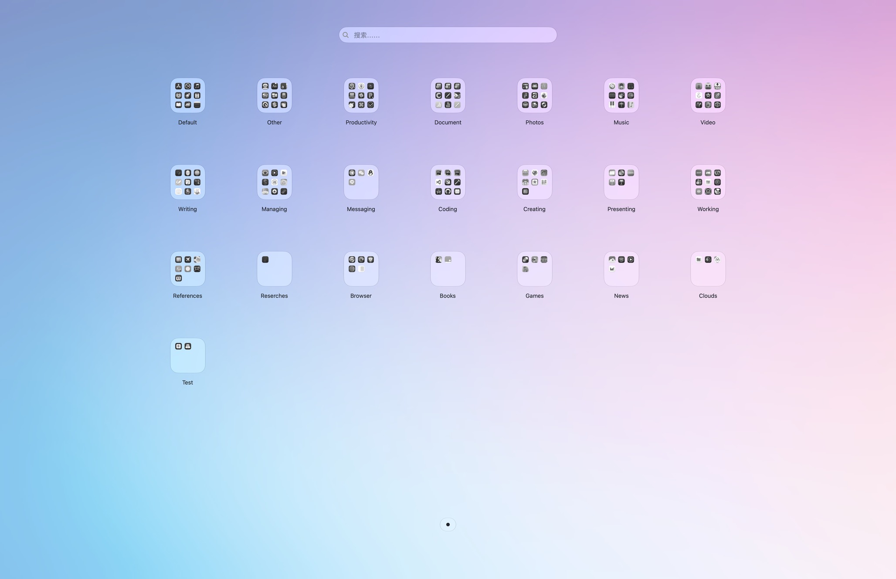
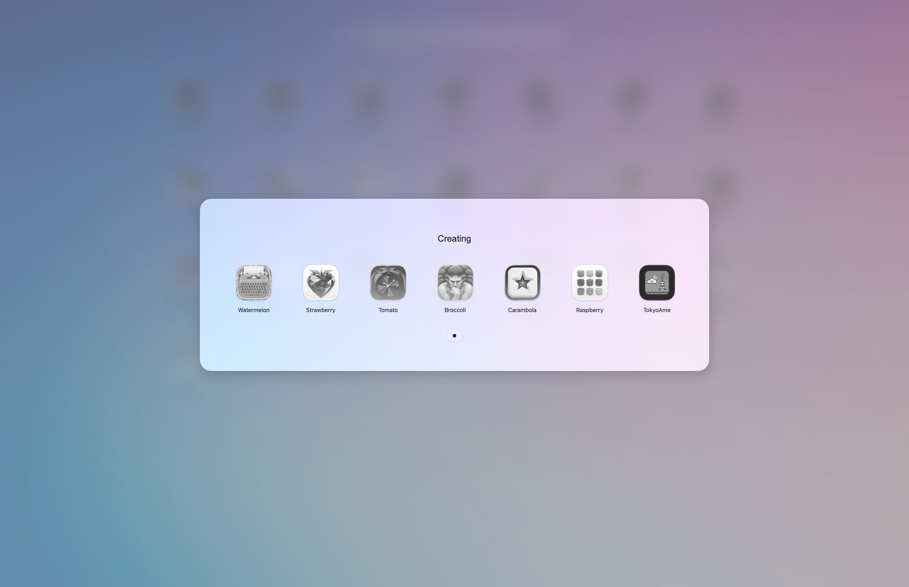

# 🫐Raspberry: 把 macOS 启动台带回来

<p align="center"><a href="README.md">English</a> · <b>简体中文</b></p>

<p align="center">
  
</p>

<p align="center"><a href="https://t.me/+AODLypeF_aYwYjNh">Telegram</a> | <a href="https://twitter.com/ryanswindows">Twitter</a> | <a href="https://weibo.com/ryanthehitos">Weibo</a></p>

<p align="center"><a href="https://github.com/Ryan-the-hito/Raspberry/releases/latest/download/Raspberry.dmg"><b>下载最新版</b></a></p>

**Raspberry 是 Mac 上的全屏应用启动器：你熟悉的那个启动台，带着你自己的分组，用液态玻璃重新做了一遍。** 点一下程序坞里的图标，这台 Mac 上的所有应用就铺在模糊的壁纸上；点一个分组，它像一块玻璃一样展开。整理可以用右键、可以拖动、也可以全程用键盘。分组、顺序和分页都存成普通文件，放在你自己的 Mac 上。

最新版本：**v0.0.18** · 界面语言：English / 简体中文 / 日本語

从 v0.0.17 起，**Raspberry 只有一个版本**。免费版和 Pro 版合并了：原来 Pro 版才有的功能（导入启动台分组、备份、多语言、自定义名称、拖动排序）现在都在这一个下载里。

<details>
<summary>旧版简介（v0.0.16 及更早，已过时）</summary>


~~Raspberry 是另一个 macOS 启动台的替代品，甚至比原生更好，帮助您在 macOS Tahoe 中归纳您的分组。~~

</details>

## 为什么做这个软件

从 macOS 26 开始，启动台没有了，换成了一个叫"App"的新应用。它会自己把软件分好类，但你不能再建自己的分组，也不能决定顺序。花了几年整理好的启动台，升级之后就不见了。

Raspberry 把它找回来，并且改掉原版一直不好用的三件事：

1. **旧的分组可以带走。** 在 macOS 15 上升级之前，Raspberry 能读出你现在启动台里的分组并保存下来，升级之后它们还在。你也可以随时把当前的排列存一份，之后回到任何一份。

2. **分组不一定要靠拖。** 原版只能把一个图标拖到另一个上面才能建组；把第 9 页的软件放进第 1 页的分组，要拖着它横穿好几页。在 Raspberry 里，右键点一个应用，选分组就行。拖动也有，而且拖的时候屏幕两侧会出现你的分组列表，目标永远不远。

3. **键盘能做所有事。** 方向键移动焦点，回车打开，Shift + 回车打开右键菜单，交换两个图标、翻页、关闭，都不用碰鼠标。

## 功能亮点

### 外观：液态玻璃

- **背景是你的壁纸，模糊过的。** Raspberry 显示的是所在屏幕那张干净壁纸的模糊画面，不是后面碰巧开着的窗口。
- **分组是一小块玻璃**，上面是前九个图标。点一下，分组从这块玻璃里长出来，变成一块玻璃面板；后面的东西变模糊、变暗。
- **翻页圆点放在一颗玻璃胶囊里**，在屏幕下方，大小足够点中。
- **整个屏幕都是 Raspberry 的**，和原来的启动台一样：主界面打开时菜单栏被盖住。把鼠标移到屏幕最上面，菜单栏就回来，Raspberry 自己的菜单和系统的图标都还能用。
- 浅色和深色外观都跟随系统。
- 右键菜单、提示框，以及"关于""更新""使用说明"这些窗口，用的都是系统自己的样式。

### 分组

右键点一个应用：

| 选项 | 做什么 |
|---|---|
| **放进分组** | 把这个应用放进某个分组，或者放进一个 **🆕 新建分组**。 |
| **移到其他分组** | （在分组里）换到另一个分组。 |
| **移出分组，放回主界面** | （在分组里）从分组里拿出来。 |
| **不在 Raspberry 里显示** | 这个应用不再出现在 Raspberry 里。它没有被删除，可以在「操作 › 🙈 已隐藏的应用」里放回来。 |
| **移到废纸篓** | 把这个应用本身移到废纸篓。 |

右键点一个分组：**重命名**，或者 **解散这个分组**（里面的应用回到主界面）。

- 放进分组、移出分组、移到废纸篓、解散分组都有动画：图标飞到它要去的地方，其余图标滑过来补位。
- 两个分组不能重名。
- 分组的顺序在所有地方都一样：主界面、右键菜单、拖动时两侧的列表。

### 拖动排序

- 在主界面拖动应用或分组，放到别的位置。在打开的分组里，拖动可以给里面的应用排序。
- 拖动一个应用时，**屏幕两侧各出现一条玻璃列表**：你的分组，最后是"新建分组"。把应用放到某个名字上，它就进了那个分组。
- 打开「📄 每一页各自独立」之后，右侧的列表换成你的每一页，应用和分组可以直接放到另一页。

### 分页

- 翻页可以用触控板滑动、鼠标滚轮、方向键，或者点圆点。旧的一页滑出去的同时，新的一页滑进来，和系统启动台一样。
- **📄 每一页各自独立（不自动补位）**（默认关）。关：所有图标是一长排，按页切开，空出来的位置由下一页补上。开：每一页有自己的图标，拿走一个不会把别的拉过来。
- **🗜 紧凑模式**：列和列之间靠得和行一样近。适合宽屏。
- **翻页速度**：「操作」菜单里的一个滑块。
- 图标大小按屏幕来算；分组的面板一定放得进所在的屏幕：先缩小图标，再减少每页的行数。

### 搜索

在顶部的搜索框里输入，按名称筛选。「🧽 关闭时清空搜索」会在每次关闭主界面时把搜索框清空。

### 键盘

有两套按键。新的一套是默认的，在「操作 › ⌨️ 新版键盘操作」里切换。

| 按键 | 新版键盘操作（默认） | 旧版 |
|---|---|---|
| ← / → | 焦点左移 / 右移 | 上一页 / 下一页 |
| ↑ / ↓ | 焦点上移 / 下移 | 焦点上移 / 下移 |
| 空格 / Shift + 空格 | 焦点到下一个 / 上一个图标 | 焦点到下一个 / 上一个图标 |
| Shift + ← / → | 上一页 / 下一页 | 把焦点上的图标和旁边的交换 |
| ⌃ 或 ⌥ 或 ⌘ + ← / → | 把焦点上的图标和旁边的交换 | |
| 回车 | 打开应用或分组 | 打开应用或分组 |
| Shift + 回车 | 打开右键菜单 | 打开右键菜单 |
| Tab | 退出打开的分组 | 退出打开的分组 |
| Esc | 关闭主界面 | 关闭主界面 |
| ⌘W | 关闭主界面 | 关闭主界面 |

有焦点的图标外面有一圈系统强调色的边框。

### 带走启动台的分组，随时备份

- **▶️ 把系统启动台的分组导入 Raspberry**：在 macOS 15 上，读出你启动台里的分组，在 Raspberry 里建出一样的分组。
- **🗂️ 备份当前的分组和排序**：把现在的排列存一份。
- **🔄 从备份恢复**：回到任何一份存过的排列。

### 所有应用，自己找到

- 第一次启动时，Raspberry 会把这台 Mac 上的应用和图标索引一遍并保存下来。它不依赖聚焦搜索。
- 运行期间，新装和卸载的应用它会自己发现。
- **👤 也显示我自己的"应用程序"文件夹里的应用**（默认关）：把 `~/Applications` 里的应用加进来。关掉它们就消失；再打开，它们回到原来的分组和位置。
- **📝 自定义某个应用的显示名称**：给应用起一个你想看到的名字。**♻️ 所有显示名称恢复为访达里的名称** 可以一次全部还原。
- **🔤 未分组的应用按名称排序**。
- **❇️ 重新读取某个应用的图标**：某个应用换了图标时用。**🧹 重新读取所有应用的图标** 是给全部应用做一遍。

### 显示在哪里

- **程序坞。** 默认情况下，Raspberry 打开时把程序坞藏起来，关闭时再放回来。「🪟 始终显示程序坞」让程序坞一直在（Raspberry 会给它留出位置）；「🌀 始终隐藏程序坞」让它一直藏着。
- **🖥 在所有桌面显示**（默认关）。开：你换到哪个桌面，Raspberry 就跟到哪个桌面，也能盖在别的应用的全屏桌面上。打开这个开关时，Raspberry 会重新启动一次。
- **🖼 只模糊壁纸**（默认开）。关：回到旧的样子，模糊的是窗口后面的任何东西。
- **🕹 传统模式（点空白处关闭）**（默认开）：点一下打开，点空白处关闭，和启动台一样。关：早期版本的双击模式。
- **🛠️ 登录时自动启动**。

### 一键更新

「关于 › 🆕 检查更新」。Raspberry 启动后不久会自己检查一次，之后每天检查一次。有新版本时，它自己下载、校验、替换，然后重新打开。分组和设置都不会丢。

### 数据都在你的 Mac 上

所有内容都在这个文件夹里，都是普通文件：

```
~/Library/Application Support/com.ryanthehito.raspberry/RaspberryAppPath
```

- `groups.json`、`main_order.json`、`app_order.json`：你的分组和所有东西的顺序。
- `alias_names.json`、`display_names.json`：显示的名称。
- `Settings/`：每个开关一个小文件。
- `Backups/`：你存下的排列。

图标缓存在 `~/Library/Caches/com.ryanthehito.raspberry/icon_cache`，随时可以删。

v0.0.16 及更早的版本，这些是你个人文件夹里的隐藏文件（`~/.launchpad_…`、`~/.raspberry_…`）。新版本第一次启动时会把它们搬到这里，旧的那些在 `Backups/before_move_<时间>` 里留一份。

<details>
<summary>旧版功能说明和演示视频（v0.0.16 及更早，已过时）</summary>

下面的视频是液态玻璃之前的样子。演示的功能现在仍然能用，除非上面的文字另有说明。

~~**导入现有的启动台分组**~~

https://github.com/user-attachments/assets/48e4dd4a-f630-4f49-9d56-ee80bacad3e1

~~**备份和恢复**~~

https://github.com/user-attachments/assets/030cad24-007d-4323-98c9-90f302cabd41

~~**第一次启动**~~

https://github.com/user-attachments/assets/6097778f-b5f9-4b0a-8b89-98c0152532d1

~~**启动应用**~~

https://github.com/user-attachments/assets/efa1de8d-48ad-4aec-996f-f4d6dcd7bbd3

~~**右键分组**~~

https://github.com/user-attachments/assets/db7b64ef-cf7a-4388-8944-2e09988c282e

~~**键盘（旧版按键）**~~

https://github.com/user-attachments/assets/1f9132fe-fadc-4546-ba25-61e39bf4abf5

https://github.com/user-attachments/assets/51c203c0-aabb-492f-b1c2-c2e58c7354a3

https://github.com/user-attachments/assets/7813bd5f-c71b-4171-aa5d-3e5075128d69

https://github.com/user-attachments/assets/88fe9d73-cb61-4089-a64d-d3f4c5e2b703

https://github.com/user-attachments/assets/d3466a4f-16c7-42a4-a476-dfe829f9c823

https://github.com/user-attachments/assets/169274b2-dbaa-40f4-b3ae-cde79a0ef8fb

https://github.com/user-attachments/assets/09f8772c-4bd4-4e84-bc49-a8d5e2106320

https://github.com/user-attachments/assets/e783b225-b88b-4d3e-8642-3202b0f5c1cd

~~**去除了原生启动台的拖动功能**：Raspberry 更倾向于右键的方式，所以不再添加这一功能。~~（拖动从 v0.0.14 起在分组里恢复，从 v0.0.17 起在所有地方都能用。）

</details>

## 界面一览

1. 主界面：分组和应用铺在模糊的壁纸上，顶部是搜索框，底部是装着翻页圆点的玻璃胶囊。

<p align="center">
  
</p>

2. 打开的分组：一块玻璃面板，浮在变暗、变模糊的主界面上。

<p align="center">
  
</p>

<details>
<summary>旧版截图（v0.0.16 及更早，已过时）</summary>


</details>

## 环境要求

- Apple 芯片（M 系列）的 Mac。
- macOS 15 或更新。Raspberry 在 macOS 27 上开发和测试。液态玻璃效果需要 macOS 26 或更新；这个版本没有在更早的系统上专门测试过。

## 下载安装

1. 从 [Releases](https://github.com/Ryan-the-hito/Raspberry/releases) 下载最新的 `Raspberry.dmg`。
2. 打开 DMG，把 Raspberry 拖进"应用程序"文件夹。
3. 打开 Raspberry。第一次启动时它要索引你的应用和图标，最长可能要几分钟。请耐心等待，不要退出。之后不会再有这一步。
4. 权限，在「系统设置 › 隐私与安全性」里：
   - **自动化**：系统询问时请允许。Raspberry 用它来隐藏和显示程序坞。
   - **屏幕录制**（可选）：Raspberry 不会主动要这个权限。如果它已经有了，模糊背景取的就是屏幕上壁纸的原样，动态壁纸也可以；没有的话，它读壁纸的图片文件。
5. **以后更新**：点「关于 › 🆕 检查更新」，剩下的它自己做。
   - **从 v0.0.16 或更早的版本升级：这一版要手动装一次**（下载 DMG，替换原来的 App）。一键更新从 v0.0.17 开始才有。
   - 如果你原来用的是免费版：现在这一份就是完整的 Raspberry，原来 Pro 版的功能都在里面。
   - 分组会保留。第一次启动时数据会搬到新的文件夹（见"数据都在你的 Mac 上"），搬完后 Raspberry 会告诉你一次。

<details>
<summary>旧版安装说明和定价（v0.0.16 及更早，已过时）</summary>

~~免费版只有基础功能，付费版除了基础功能以外，还有高级功能（导入现有的启动台分组、手动备份和恢复、英语之外的多种语言）。~~

~~购买付费版：访问 Buy me a coffee 页面，填写姓名和邮箱，付款成功后会收到 Pro 版的软件包。~~

~~更新软件：下载 DMG 后选择"替换"。~~

</details>

## 使用说明

1. **打开和关闭。** 点程序坞里的 Raspberry 图标打开主界面，再点一次关闭。Esc、⌘W、点空白处也都能关闭。
2. **打开应用或分组。** 点一下。分组会展开成一块面板；点面板外面，或者按 Tab，回到主界面。
3. **建一个分组。** 右键点一个应用 ›「放进分组」›「🆕 新建分组」；或者把应用拖到侧边列表里的"新建分组"上。右键点分组可以重命名。
4. **排顺序。** 拖动图标和分组；或者用方向键把焦点移到一个图标上，再和旁边的交换（⌃ / ⌥ / ⌘ + ← / →）。「🔤 未分组的应用按名称排序」可以一次排好所有没分组的应用。
5. **用菜单。** 主界面会盖住菜单栏。把鼠标移到屏幕最上面，菜单栏就出现，上面有 Raspberry 的 **操作**、**关于**、**语言** 三个菜单。这一页提到的所有开关都在「操作」里。
6. **从 macOS 15 升级到 macOS 26 或更新。** 请在升级系统**之前**做：
   1. 在 macOS 15 上安装并打开 Raspberry。
   2. 点「操作 › ▶️ 把系统启动台的分组导入 Raspberry」。
   3. 升级系统。
   4. 打开 Raspberry，分组都在。
7. **哪里看着不对的时候。**
   - 某个应用的图标是旧的：「❇️ 重新读取某个应用的图标」，然后选那个应用。
   - 很多图标都不对：「🧹 重新读取所有应用的图标」。不要连点两次，完成之前不要退出。
   - 从头再来：「🗑 清空全部分组和排序并重新启动」会清掉 Raspberry 的分组和设置（不会动你的应用）。如果从启动台导入没成功，先做这一步，再导入一次。
8. **软件里的说明**：「关于 › 🔤 使用说明与帮助」。

## 注意事项

1. 从 v0.0.16 或更早的版本升级，要手动装一次；之后更新就是点一下。
2. 隔一段时间用「🗂️ 备份当前的分组和排序」存一份。
3. 「移到废纸篓」是把应用本身移到废纸篓。「不在 Raspberry 里显示」只是不再显示它。
4. 打开「🖥 在所有桌面显示」之后，Raspberry 启动的头一会儿程序坞里没有它的图标，窗口准备好之后图标才出现。这是有意这样做的。

## Q&A

遇到问题，请先看 **[Q&A](https://github.com/Ryan-the-hito/Q-A)❓** 里有没有现成的办法，或者[给我写信](mailto:sweeter.02.implant@icloud.com)。

## 证书信息

GPL-3.0，详见 LICENSE 文件。

## 特别致谢

1. [Qt](https://github.com/qt) / PyQt6
2. [blacktop/lporg](https://github.com/blacktop/lporg)（MIT）：读取启动台的排列。

感谢每一位提建议和反馈问题的朋友。

## 支持作者

如果你喜欢 Raspberry，点一个 Star 或者提一个 Issue 都是帮助。Raspberry 是免费的；如果你愿意支持它继续开发：

[](https://www.buymeacoffee.com/ryanthehito)

<p align="center">
  
  
</p>

## 版本历史

### v0.0.18

v0.0.16 之后的所有改动（v0.0.17 没有单独发布）。

新功能：

1. 只有一个 Raspberry：免费版和 Pro 版合并，名字里不再有"Pro"。
2. 全面换成液态玻璃：背景是模糊的干净壁纸，分组是玻璃方块，分组面板从方块里长出来，翻页圆点放进玻璃胶囊，菜单、提示框和窗口都用系统样式。
3. 主界面盖住菜单栏；鼠标移到屏幕最上面，菜单栏就回来。
4. 拖动：主界面上的应用和分组都能拖，屏幕两侧有分组（或每一页）的列表。
5. 「📄 每一页各自独立」。
6. 「🙈 已隐藏的应用」，以及右键菜单里的"不在 Raspberry 里显示"。
7. 「👤 也显示我自己的"应用程序"文件夹里的应用」。
8. 「🖥 在所有桌面显示」，也能盖在全屏应用上。
9. 一键更新。
10. 动画：翻页时两页一起滑动；图标飞进、飞出分组；打开时从中间向外淡入；移到废纸篓和解散分组也有动画。

调整：

1. 紧凑模式的意思改成"列和行一样近"；单独的"自动紧凑"开关去掉了。
2. 图标大小按屏幕来算，分组面板一定放得进屏幕。
3. 数据从个人文件夹里的隐藏文件搬到 `~/Library/Application Support/com.ryanthehito.raspberry`。
4. 分组的顺序在每个列表里都一样；分组不能重名。

修复：

1. 右键菜单开着时图标被重新排列，导致软件退出。
2. 在应用上右键，出来的却是分组的菜单。
3. "重新读取某个应用的图标"提示应用不在列表里。
4. 主界面各行高度不一致。

### v0.0.16

1. 新增一组全新的快捷键，更直观，默认启用；习惯旧快捷键的可以在选项里切回去。
2. 新增按名称排序：没有放进分组的应用可以按首字母排序。
3. 修复：无法启动用 Qt 做的软件。
4. 修复：软件名称没有按访达里的名称显示。
5. 新增自定义名称：给某个软件起你喜欢的名字；可以一次全部还原。
6. 导入启动台分组时按访达里的名称匹配，更准确。
7. 新增选项：关闭主界面后自动清空搜索框。
8. 紧凑模式按屏幕记住结果。

### v0.0.15

1. 新增翻页速度滑块。
2. 触控板翻页的动画更灵动。
3. 修复：自动检查更新时，手动检查更新不起作用。
4. 新增自动紧凑模式，接不同宽度的屏幕时自动切换。

### v0.0.14

1. 分组内部可以拖动排序。
2. 修复：紧凑模式下搜索导致布局错乱。

### v0.0.13

1. 新增后台检查新版本。
2. 新增紧凑模式。
3. 修复：从分组里移出的软件排到了最前面，现在排在最后。

### v0.0.12

1. 修复：点部分空白区域无法关闭主界面。
2. 新增鼠标滚轮翻页。
3. 新增 Esc 键关闭主界面。
4. 新增"始终显示程序坞"和"始终隐藏程序坞"。
5. 点一次程序坞里的图标打开主界面，再点一次关闭。

### v0.0.11

1. 新增清除各种缓存的选项，当 app 遇到功能问题时，比如像之前有用户反馈无法备份的时候，使用此选项重置环境。
2. 修复搜索状态下软件分组导致软件重复的问题。
3. 修复分组页面中删除 app 无法及时更新的问题。
4. 修复无法在初始状态生成 main order 控制文件的问题。
5. 修复错误生成的 main order 控制文件阻止备份功能的问题。

### v0.0.10

1. 修复备份恢复旧 Launchpad 时只能获取第一页文件夹的问题。
2. 新增传统点击模式，默认开启，交互方式和 Launchpad 完全一致，只需要单击，不需要再双击。
3. 给主界面消失的过程增加渐变退出动画。

### v0.0.9

- 第一次运行时，新增一个提示窗口，显示 Raspberry 正在索引应用缓存。

### v0.0.8

- 修复没有显示正确版本号的 bug。
- 新增关闭主界面的快捷键。

### v0.0.7

新增日语界面。

### v0.0.6

新增中文界面。

### v0.0.5

- 修复使用多个显示器时尺寸无法调整的问题；
- 修复可以被启动两次的问题。

### v0.0.4

- 修复弹出的警告窗口无法使用深色主题的问题；
- 修复右键菜单里重命名的问题；
- 修复点主窗口空白区域无法关闭的问题；
- 新增备份和恢复备份。

### v0.0.3

- 修复深色主题下菜单颜色不对的问题；
- 新增搜索框获得焦点时的动画；
- 新增分组的玻璃质感；
- 所有图标显示时顶部对齐；
- 新增翻页动画。

### v0.0.2

修复若干问题。

### v0.0.1

最初的版本。
